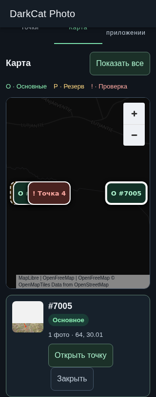
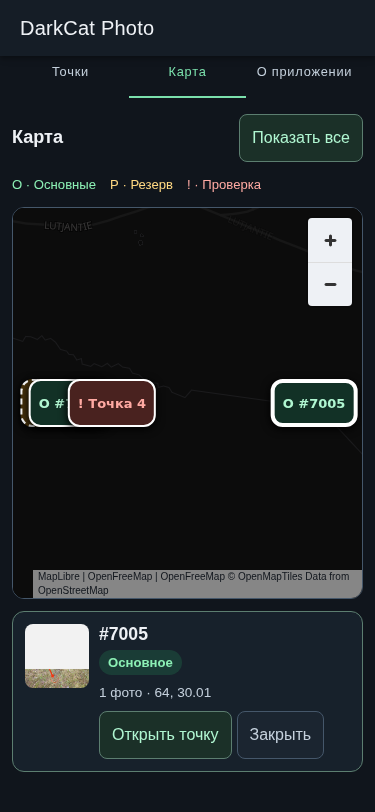
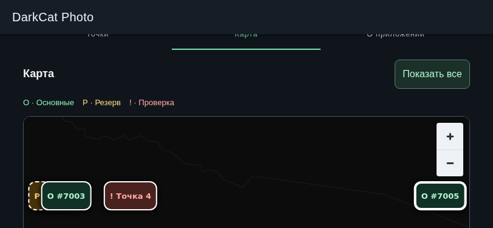
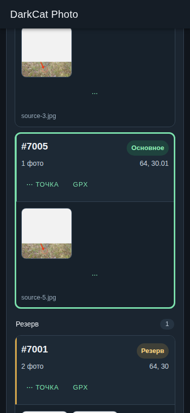
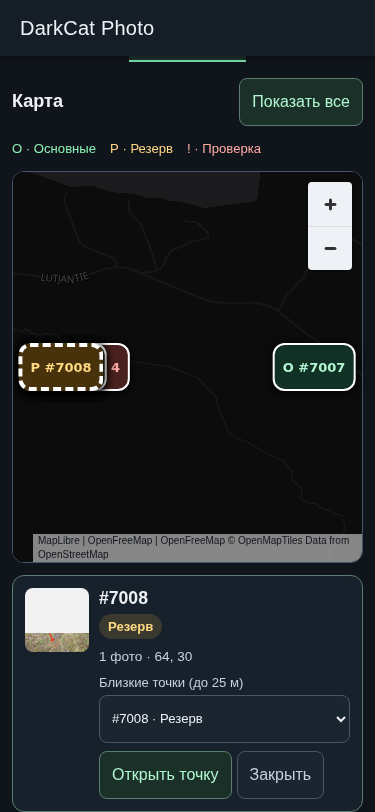

# DarkCat Photo 0.5.0 — интеграция Stage A + B

Задание: [agent-dispatch#550](https://github.com/dedtsss/agent-dispatch/issues/550), та же ветка `manual/darkfoto-mvp-550` и [PR #52](https://github.com/dedtsss/distance-points-on-the-map/pull/52).
Stage B продолжает чистый Stage A head `893d9d8f93b7ac1f46c854021ffe3ae7c90cdc35`.
[Каноническое решение](https://github.com/dedtsss/agent-dispatch/issues/550#issuecomment-6104308243) отменяет прежний satellite/credential gate: только **MapLibre GL JS + OpenFreeMap Dark**, без ключа и satellite.

## Реализация

- Три вкладки: «Точки», «Карта», «О приложении». MapLibre 6.13.0 закреплён в lockfile; движок и локальный Vite worker загружаются при первом посещении карты.
- Production style: `https://tiles.openfreemap.org/styles/dark`. Атрибуция MapLibre/OpenFreeMap/OpenMapTiles/OpenStreetMap остаётся видимой. Собственного tile proxy, API-key plumbing или изменения runtime access нет.
- `sessionMapPoints` — вычисляемая проекция тех же `rows` и текущих результатов классификации. Состав, представитель, координаты, количество фото и статус пересчитываются существующими правилами. Удалённые/пустые/no-coordinate точки не становятся активными маркерами.
- Основные/Резерв/Проверка различаются цветом, символом и подписью; у Резерва дополнительная пунктирная рамка. Preview позволяет выбрать отдельную близкую точку (до 25 м), включая разные logical IDs с одинаковыми координатами. Маркеры доступны кнопками с клавиатуры; близкие маркеры можно разделить увеличением масштаба.
- Компактный preview показывает индекс/идентичность, статус, координаты, число фото и локальное фото представителя. «Открыть точку» переключает вкладку и через реестр карточек фокусирует, прокручивает и подсвечивает точный logical point ID. Изменения сессии не теряются.
- Маркеры обновляются после append, move/remove/restore фото и remove/restore точки; выбранный preview тоже вычисляется из текущей проекции. У карты нет отдельной копии point model.
- Первый viewport и «Показать все» вписывают текущие точки, включая короткую дугу при пересечении линии перемены дат. Обычные правки и переключения вкладок сохраняют canvas/pan/zoom. Empty→restore/new session заново задаёт начальный viewport.
- Сессия без активных точек с координатами не делает запросов к provider. Загрузка ограничена 15 секундами; ошибки сети/движка показывают явное сообщение и retry. Неуспешная частичная загрузка не выдаётся за готовую карту.
- 0.5.0 / versionCode 15; `app.darkfoto.mvp`, pin сертификата и путь updater tags сохранены. `releaseReady: false` обозначает непубликованную проверочную сборку. История 0.5.0 подготовлена без фиктивной даты выпуска в том же `CHANGELOG.md`, который читает About/update.

## Проверки и evidence

- `cd darkfoto && npm test`: 60 unit tests; browser OCR и real JPEG OCR; регрессии 0.4.0 membership/append/link/TXT/GPX/publication; полный Stage A browser acceptance; новый deterministic-provider map acceptance с настоящим MapLibre/WebGL/worker; попиксельная проверка утверждённых launcher/splash ресурсов.
- `npm run test:map:live`: настоящий production Dark style, реальные provider tiles, статусы и preview, click/keyboard marker selection, exact point handoff, live representative/member/point/append changes и сохранение viewport. Локальная проверка получила 13 успешных tile responses. Отдельные deterministic tests проверяют HTTP 503, 15-second timeout, retry и empty→restore.
- Responsive acceptance: 320×812, 375×812, 812×375; все маркеры внутри canvas после fit; отсутствие горизонтального overflow; preview и point handoff. Stage A сохраняет 9-photo 3×3, 5/9→4↔5↔6, три LIFO restore, sanitized edited export/failure и четыре persisted MRU.
- `npm run android:sync` (включает build), native `:app:testDebugUnitTest :app:assembleDebug :app:assembleDebugAndroidTest assembleRelease`: 9 native tests, unsigned APK, package/version/code проверяются через `aapt`; `apksigner verify` отвергает unsigned artifact.
- Root Web/Cloudflare builds и 2 Onion tests. Normal Web/Android CI запускаются на точном pushed head; Android CI дополнительно проверяет **live production map** и сохраняет `/tmp/darkcat-stage-a`, `/tmp/darkcat-stage-b` и native reports. Итоговые run links/head/result находятся в PR и обязательном ledger Issue #550.
- Root `src/` не изменяется. Ранее зафиксированный локальный root OCR fixture failure `four-digit-leading-zero` остаётся историческим ограничением Stage A; normal Web CI проверяется отдельно на финальном head.

Committed screenshots ниже получены от реального OpenFreeMap, не от test-provider fixture. Исходные фото в тесте — контролируемые локальные fixtures; tile provider получает только обычные запросы карты.

## Reuse и ограничения проверки

Решение владельца уже определило движок и provider. Проверены [OpenFreeMap quick start](https://openfreemap.org/quick_start/) с Vite local-worker integration, официальный [MapLibre Map API](https://maplibre.org/maplibre-gl-js/docs/API/classes/Map/), [Marker API](https://maplibre.org/maplibre-gl-js/docs/API/classes/Marker/) и [релиз 6.13.0](https://github.com/maplibre/maplibre-gl-js/releases/tag/v6.13.0) от 06.10.2026. BSD-3-Clause, npm/Node совместимы с текущим CI. Использованы готовые MapLibre marker/navigation/attribution/fit/resize/error APIs и небольшой React adapter вместо новой native map архитектуры или собственной картографии.

Проверен upstream [Android asset-origin issue #4451](https://github.com/maplibre/maplibre-gl-js/issues/4451): он касается `file://`/GeckoView `resource://android`. Здесь сохранён существующий Capacitor `http://localhost` origin и worker из тех же packaged assets; origin checks не отключались. Реальная GPU/WebGL совместимость конкретного Android WebView проверяется на устройстве, не выводится из успешной desktop Chromium проверки.

Physical Android field checks остаются из [Stage A](STAGE-A.md): SAF provider/cancel/no space/rename, orientation, IME, launcher/splash, shares и updater installer. Дополнительно: реальные WebView pan/pinch/zoom, переключение portrait/landscape, airplane-mode→retry и «Открыть точку». Дополнительный Stage A emulator workflow ранее дважды останавливался на Enable KVM; это не выдаётся за runtime emulator PASS. Normal Android CI проверяет native tests/compilation и map в Chromium.

Нет маршрутов, navigation, geometry editing, geofencing, offline tile download, satellite или credentials. Ни merge, ни production signing, ни release в этом checkpoint не выполняются.
